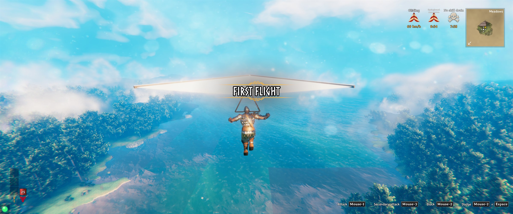
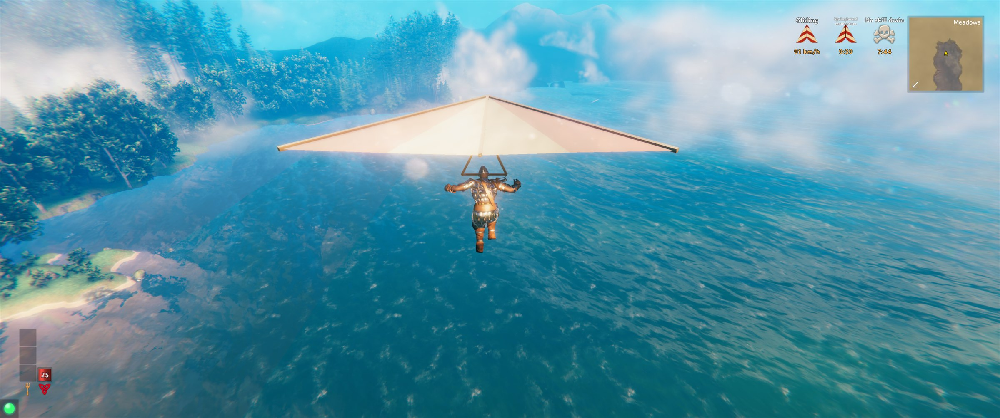
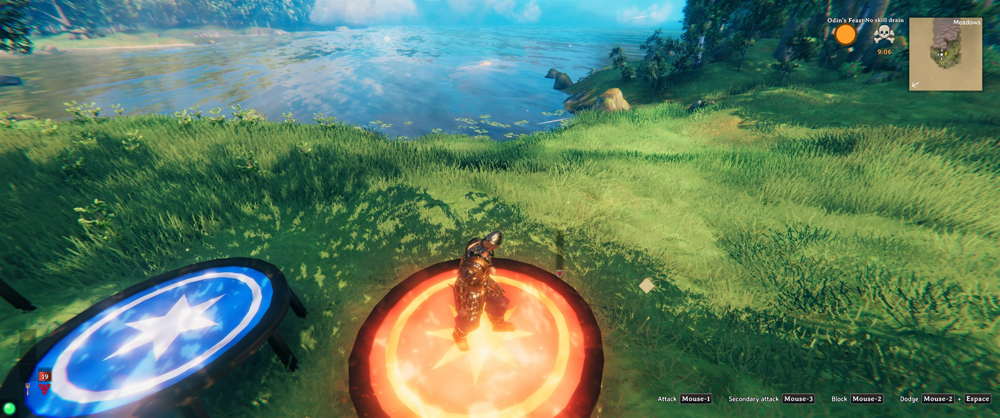
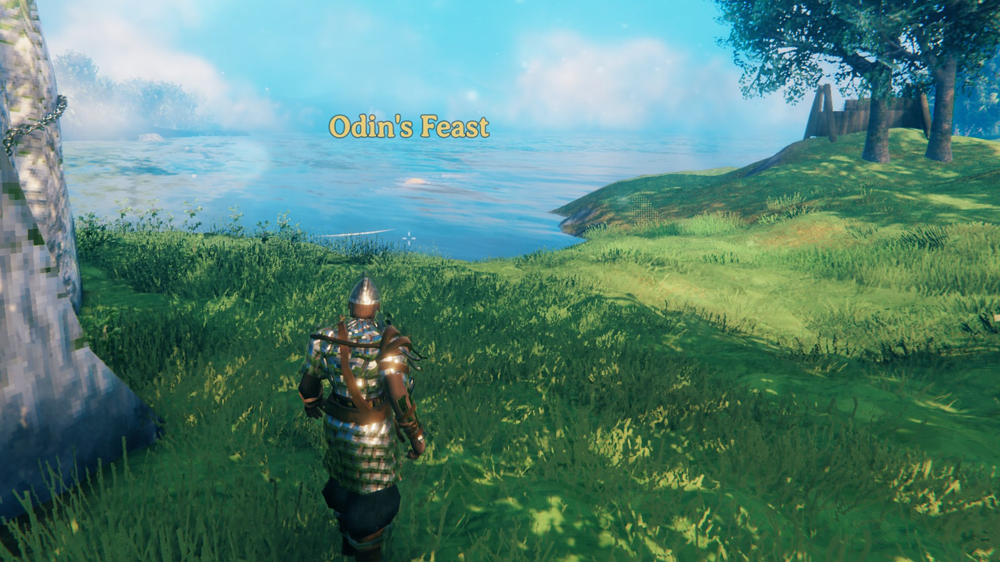

# 6Vikings

Valheim mods made by San Tiépi (team 6Vikings) for a small group of friends, shared on Thunderstore. This page holds the screenshots and the links; the mods themselves install with a mod manager (Gale, r2modman).

They are in **beta**: tested a lot in single player, running on our 3-player dedicated server. Made with AI help (Claude). Since Envol 1.0.2, Loki 1.1.0, Saga 1.1.0, Coeur 1.0.1 and Canons 1.0.1, every in-game text follows your game language: English, or French when your game is in French.

## Envol: glider and springboards

A glider you wear, and three springboards you build that throw you 100, 400 or 1,500 m up (wood, iron, flametal). Dive to gain speed, pull back to turn it into height. Each launch gives ten minutes without stamina cost or fall damage.

[Envol on Thunderstore](https://thunderstore.io/package/6Vikings/Envol/)

## Loki: a whim every in-game day

Every new day, the server picks one of three whims for everyone: Feather Day (low gravity, no fall damage), Odin's Feast (food lasts twice as long) or Hel's Mist (you see further, new monsters get a star, double loot).

[Loki on Thunderstore](https://thunderstore.io/package/6Vikings/Loki/)

## And three more

- [Saga](https://thunderstore.io/package/6Vikings/Saga/): a mocking line in chat each time you die, and `/saga` for your deeds.
- [Coeur](https://thunderstore.io/package/6Vikings/Coeur/): multiplayer fix for BlightedWorldHeart 1.1.2.
- [Canons](https://thunderstore.io/package/6Vikings/Canons/): stops the "Missing prefab hash" log spam from ValheimRAFT cannonballs.

Feedback and bug reports: [Discord 6Vikings Mods](https://discord.gg/4vejaEdNrP), forum #bugs.

---

## En français

Des mods Valheim faits par San Tiépi (équipe 6Vikings) pour un petit groupe d'amis, partagés sur Thunderstore. Ici : les captures et les liens. En bêta ; faits avec l'aide d'une IA (Claude). Depuis Envol 1.0.2, Loki 1.1.0, Saga 1.1.0, Coeur 1.0.1 et Canons 1.0.1, les textes du jeu suivent sa langue : français si le jeu est en français, anglais sinon.

Envol (planeur et tremplins), Loki (un caprice par jour de jeu), Saga (une réplique moqueuse à chaque mort), Coeur (correctif multijoueur de BlightedWorldHeart) et Canons (fait taire les boulets de ValheimRAFT dans le journal).
